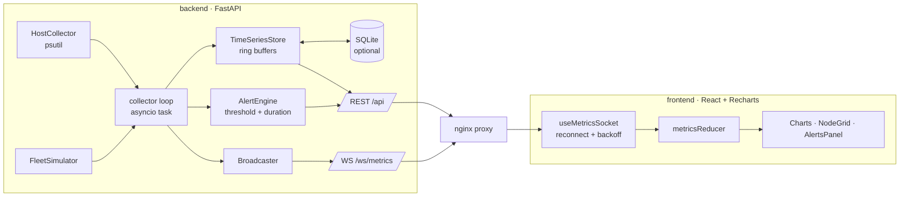

<!-- topics: fastapi,react,typescript,websocket,monitoring,real-time,recharts,alerting,observability,docker -->
# Realtime Monitoring Dashboard

Infra health dashboard: a FastAPI backend collects host metrics with psutil plus a simulated node fleet, keeps them in ring buffers with optional SQLite persistence, evaluates threshold-for-duration alert rules, and streams everything over WebSocket to a React + Recharts dark-theme UI.

[](https://github.com/AkibUllah/realtime-monitoring-dashboard/actions/workflows/ci.yml)


## Try it live

| | |
|---|---|
| API reference | https://akibullah.github.io/realtime-monitoring-dashboard/ — Swagger UI rendered from the exported `openapi.json` (static; the Codespace runs the real service and WebSocket stream) |
| Run in your browser | [](https://codespaces.new/AkibUllah/realtime-monitoring-dashboard?quickstart=1) — starts the collector API (real host metrics of the Codespace plus the simulated fleet) and the Vite dev server; open port 5173 for the dashboard and port 8000 for `/docs` |
| One-click deploy | [](https://render.com/deploy?repo=https://github.com/AkibUllah/realtime-monitoring-dashboard) — API and nginx-served dashboard from `render.yaml`; the dashboard proxies `/api` and `/ws` to the API over Render's private network |
| Local | `docker compose up --build -d` then http://localhost:8080 (see Quick Start) |

## Why this exists

Operating a private cloud means staring at compute nodes all day: which hypervisor is saturating, which one quietly stopped sending traffic, whether a disk has been filling for a week. Full Prometheus + Grafana is the right answer at scale, but the moving parts are worth understanding from the inside: a collector loop, a bounded time-series store, alert state that does not flap, and a push channel to the browser that survives reconnects. This project is that pipeline end to end, small enough to read in an afternoon and realistic enough to run on a laptop against its own host metrics.

## Features

- Host collector (psutil): CPU, memory, disk, network in/out as kbps deltas
- Deterministic fleet simulator: N nodes across Dhaka/Chittagong regions with mean-reverting walks, CPU spikes, memory leaks and node-down incidents
- Ring-buffer time-series store per (node, metric) with inclusive range queries and bucket-average downsampling
- Optional SQLite persistence: samples are appended each tick and replayed into the ring buffers on restart
- Alert rules with threshold + `for_seconds` duration and OK → FIRING → RESOLVED → OK state, per node, with node/role/region filters and a notification log
- WebSocket `/ws/metrics`: snapshot with recent history on connect, then one message per tick; REST for history, nodes, rules and notifications
- React UI: live area charts (CPU with fleet average, memory, disk, network), node grid with status and inline bars, alerts panel with rule toggles, time-range selector, connection badge
- Reconnecting WebSocket hook with jittered exponential backoff; the server snapshot refills the gap missed while offline
- docker compose with an nginx reverse proxy that forwards `/api`, `/health` and upgrades `/ws`

## Architecture



Key decisions:

- **One tick, one message.** The collector loop records, evaluates alerts and broadcasts in a single pass, so what the UI shows is exactly what the alert engine saw.
- **Ring buffers, not a database, on the hot path.** `deque(maxlen)` per series gives O(1) appends and bounded memory; SQLite is write-behind and only used to warm up after a restart.
- **Alerts have memory.** `for_seconds` requires a sustained breach, the FIRING → RESOLVED transition emits exactly one notification each, and RESOLVED lingers for a TTL so the panel shows what just recovered.
- **The snapshot is authoritative on reconnect.** The client throws away its local series and takes the server's history, which closes the gap without any replay protocol.
- **Timestamps are Unix seconds everywhere** (store, wire, charts), so there is no timezone handling in the pipeline.

## Tech Stack

| Layer | Choice |
|---|---|
| API | FastAPI 0.115, Pydantic v2, uvicorn (websockets) |
| Collection | psutil 6, in-process asyncio loop |
| Storage | in-memory ring buffers, SQLite (stdlib) |
| Frontend | React 18.3, TypeScript 5.4, Vite 5, Tailwind 3.4, Recharts 2.12 |
| Tests | pytest + Starlette TestClient (incl. WebSocket) · vitest + Testing Library |
| Ops | Docker, docker compose, nginx, GitHub Actions |

## Quick Start

Docker Compose (UI on http://localhost:8080, API docs at http://localhost:8080/docs, liveness at http://localhost:8080/health):

```bash
docker compose up --build -d
open http://localhost:8080
```

Local development:

```bash
# backend
cd backend
python3 -m venv .venv && .venv/bin/pip install -e ".[dev]"
cp .env.example .env
.venv/bin/uvicorn app.main:app --reload     # http://localhost:8000/docs

# frontend (new terminal)
cd frontend
npm install
npm run dev                                 # http://localhost:5173 (proxies /api and /ws)
```

Set `FLEET_SIZE=0` to monitor only the real host, or `HOST_COLLECTOR_ENABLED=false` for a pure simulation.

## API

| Method | Path | Purpose |
|---|---|---|
| GET | `/health` | Liveness + summary (nodes, firing alerts, ws clients, ticks) |
| GET | `/api/summary` | Same summary without the status wrapper |
| GET | `/api/nodes` | Latest snapshot per node |
| GET | `/api/metrics` | Metric catalogue with units |
| GET | `/api/metrics/history?node=&metric=&range=15m&step=10` | Points `[[ts, value], …]`, optional bucket averaging |
| GET | `/api/snapshot?range=5m` | What a WebSocket client receives on connect |
| GET | `/api/alerts` | Active (firing/resolved) alert states |
| GET / POST | `/api/alerts/rules` | List / create rules |
| PATCH / DELETE | `/api/alerts/rules/{id}` | Update / delete a rule |
| GET | `/api/notifications?limit=50` | Alert transitions, newest first |
| WS | `/ws/metrics` | `snapshot` on connect, then `tick` messages; send `{"type":"ping"}` for `pong` |

Rule payload: `{"name", "metric": "cpu|memory|disk|net_rx|net_tx", "op": ">|>=|<|<=", "threshold", "for_seconds", "severity": "info|warning|critical", "node_filter": "node-03|db|dhaka-1|null", "enabled"}`.

## Project Structure

```
realtime-monitoring-dashboard/
├── backend/
│   ├── app/
│   │   ├── collectors/     # host.py (psutil), fleet.py (simulator)
│   │   ├── store/ring.py   # RingBuffer, TimeSeriesStore, SqlitePersistence
│   │   ├── alerts/engine.py# AlertRule, AlertEngine, Notification
│   │   ├── api/            # routes.py (REST + WS), schemas.py
│   │   ├── service.py      # MonitoringService + Broadcaster, collector loop
│   │   ├── config.py · models.py · main.py
│   └── tests/
├── frontend/
│   ├── src/
│   │   ├── components/     # MetricChart, NodeGrid, AlertsPanel, TimeRangeSelector, ConnectionBadge
│   │   ├── hooks/useMetricsSocket.ts
│   │   └── lib/            # metrics reducer, format, backoff, api, types
│   ├── Dockerfile · nginx.conf.template
├── nginx/nginx.conf        # reverse proxy with WebSocket upgrade
├── docker-compose.yml
└── .github/workflows/ci.yml
```

## Testing

```bash
cd backend && .venv/bin/python -m pytest     # 29 tests
cd frontend && npm test                       # 21 tests
```

Backend: ring buffer eviction, ordering and downsampling; SQLite round-trip, prune and warm start; alert duration, reset, resolve TTL, per-node state, filters, rule updates; fleet determinism, bounds and incidents; REST history/range/step validation, rule CRUD; WebSocket snapshot, live tick and ping/pong through `TestClient`. Frontend: reducer (snapshot, tick, out-of-order, retention trim, notification merge, reconnect), range filtering, fleet average, formatting, backoff schedule, series merging, and rendering/interaction of NodeGrid, TimeRangeSelector, ConnectionBadge and AlertsPanel.

## Roadmap

- Pluggable collectors for remote agents (push over HTTP) and an OpenStack Nova hypervisor stats collector
- Webhook / email notifier behind the notification log
- Per-rule silences and maintenance windows
- Server-side downsampled history for the 1h range to shrink the snapshot payload
- Auth on the rules API

## License

MIT © 2026 Akib Jafor
